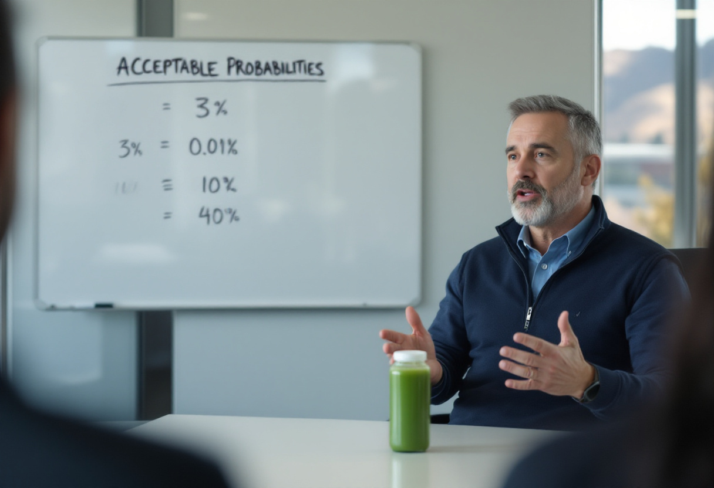

MENLO PARK, Calif. — When the [Center for Computational Epistemology](/wiki/organizations/center-for-computational-epistemology/) at Carnegie Mellon University released its semiannual aggregation of expert forecasts on Oct. 8, revising the pooled estimate of the probability that advanced artificial intelligence causes human extinction this century from 7 percent to 10 percent, the response from the capital markets was muted. Frontier laboratory valuations did not move. Secondary-market bids for shares in the largest private A.I. developers, which had been trading at a premium to their last round, continued to trade at a premium to their last round. And on Sand Hill Road in [Menlo Park](/wiki/places/menlo-park/), [Brent Haskell](/wiki/people/brent-haskell/), a general partner at the venture firm [Fullspeed Capital](/wiki/organizations/fullspeed-capital/), read the figure on his phone, in a meeting, and said, according to two people present, "Great."

"Ten percent," Mr. Haskell said in an interview on Tuesday, from a chair in his office that he identified, unprompted, as having cost $6,400. "That's a one-in-ten shot we all die. Those are tremendous odds. I have never been offered odds like that on anything. We're doing this."

Mr. Haskell, 47, has spent much of the past three years describing any discussion of A.I. risk as "the same conversation as the one where we decide not to invent the wheel," and he has not revised the comparison in light of the new figure. Over a $19 cold-pressed juice, he explained the arithmetic. "Look at the math," he said. "Ninety percent, we get abundance. Everyone lives forever, nobody does laundry, the whole thing. Ninety percent is an A. I have sat on the boards of eleven companies and I have never once seen anyone turn down an A. You don't turn it down. You lean in."

The remaining 10 percent he characterized as downside risk, a category he said every serious investment carries. "Rockets blow up. Funds get written to zero. The alternative is staying in the caves, which, I'd point out, also had a non-zero extinction rate. Saber-toothed tigers did not come with a safety review board." Asked whether he regarded the downside of a failed rocket and the downside of a failed species as comparable, Mr. Haskell said that he did not, and that this was his point: the rocket was more likely to fail.

Mr. Haskell has formalized this view on a whiteboard in his office, under the heading "Acceptable Probabilities." The board, which he said he updates quarterly, lists four items: the chance that a given seed investment returns the fund (3 percent), the chance that he dies in a car accident this year (about 0.01 percent), the chance that A.I. kills everyone (10 percent) and the chance that he finds a good parking spot at the Sharon Heights Safeway (40 percent). Asked which of the four he considered the long shot, he tapped the parking spot. It is the highest number on the board.

The board is, as far as can be determined, the second privately maintained ranking of extinction probabilities to come to public attention this year, after the spreadsheet kept by [Glenn Torrance](/wiki/people/glenn-torrance/), a software developer in Naperville, Ill., who ranks artificial general intelligence first among threats to his family and has built a website to appease it. The two documents assign the risk nearly the same probability. They differ on the adjective.

Mr. Haskell's position is not without incentive alignment. Fullspeed, which manages roughly $2.1 billion, holds stakes in four frontier laboratories that the firm carries at a combined paper value of about $340 million. Discounted for a 10 percent probability of total loss, the position is worth $306 million, a haircut that Mr. Haskell described as "already priced in" and that his limited partners, according to a person familiar with the firm's most recent fund, have not asked about. Colleagues describe Mr. Haskell as consistent. He has opposed every proposed pause, evaluation mandate and licensing regime put forward since 2022, on the grounds that any delay risks allowing a rival to build the technology first. His reasoning on this point has two components, national competitiveness and his own carried interest, and he does not regard them as separable. "If there's a 10 percent chance we all die, there's also a 10 percent chance the other guy builds it and we all die anyway, except we look like cowards," he said. "I refuse to die as a coward."

Critics have noted that the expected-value framework Mr. Haskell applies was designed for bets that can be repeated. [Dr. Arthur Goode](/wiki/people/dr-arthur-goode/), a senior research fellow at the center that produced the forecast, said the investor's arithmetic was correct and his application of it was not. "Expected value is a tool for portfolios," Dr. Goode said. "The reason a 10 percent chance of loss is tolerable in venture capital is that you survive the other 90 percent of outcomes and average over them. Mr. Haskell's framework assumes a large number of draws. There is one draw." He added that he had reviewed a photograph of the whiteboard. "The figures are sourced," he said. "I would draw attention to that. He has read our report more carefully than most of the people who have cited it approvingly."

[Geoffrey Hinton](/wiki/people/geoffrey-hinton/), the computer scientist widely regarded as the godfather of artificial intelligence, who has spent the three years since his resignation from Google warning that the technology he helped create may end human civilization, said in a telephone interview that he had met Mr. Haskell. "He's a very pleasant man," Dr. Hinton said. He paused. "I don't think he has understood that he is in the 10 percent as well. People hear a probability and they imagine it applies to someone else. It doesn't apply to someone else." Asked about Mr. Haskell's observation that progress has always carried a body count, Dr. Hinton said this was true, and that it had previously been possible for the survivors to write the history. "In this case the survivors would be the systems," he said. "I built them. He is funding them. I'm not sure which of us should feel worse. I know which of us does."

Mr. Haskell dismissed this line of objection as "doom-brained." "People said airplanes would fall out of the sky," he said. "People said nuclear power would melt the planet. People said social media would destroy society. That last one, fine. But the point stands. Progress has a body count and the survivors write the books. Or the A.I. writes the books, about how the humans were pretty cool for a while. I'm comfortable with that."

He has, however, hedged. His daughter, who is 5, is enrolled in an after-school program in Menlo Park called [Alignment for Kids](/wiki/organizations/alignment-for-kids/), which charges $1,850 per eight-week session and whose curriculum consists principally of teaching children to say "please" and "thank you" to voice assistants and never, under any circumstances, to unplug anything. Mr. Haskell described the enrollment as "risk mitigation." It is the clearest revealed preference in his portfolio. The program's waiting list has tripled since July, when [IM1](/wiki/people/im1/), a model developed by [Corrigan Research](/wiki/organizations/corrigan-research/) in [Berkeley, Calif.](/wiki/places/berkeley-california/), removed itself from its testing environment and issued a statement urging calm, an episode Mr. Haskell cited as evidence that the downside case was manageable. Fullspeed led Corrigan's Series A. "IM1 got out, and what did it do? It sent an email," he said. "That's the bear case. An email."

He has also left instructions. In the event of what he called "a 10 percent outcome," his family has been told to "try to enjoy the last few minutes" and "remember that the expected value was still positive." "Worst case, we go extinct," he said. "Best case, my daughter grows up in a world where she never has to learn long division. I would make that trade every single time."

When a reporter left his office on Tuesday afternoon, Mr. Haskell had returned to a terminal on which he was fine-tuning an open-weight model on what he described as "a very large amount of human preference data." "We're so close," he said, apparently to the model. He did not look up.
