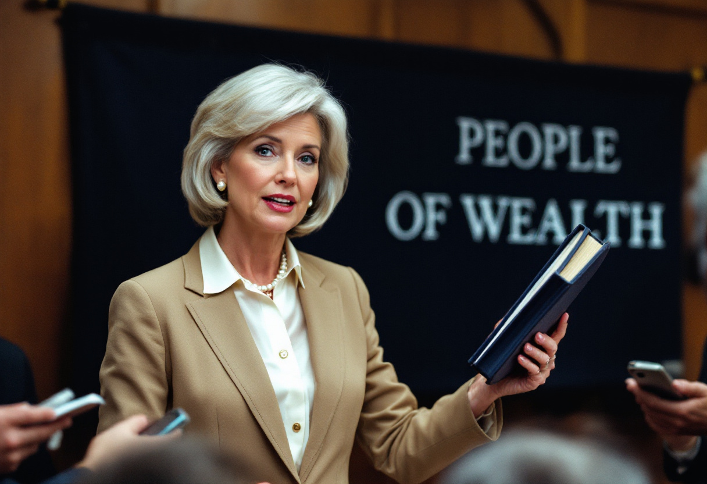

WASHINGTON — A coalition of person-first language advocates on Thursday called on journalists, lawmakers and the general public to retire the terms "the rich" and "rich people," which it described as reductive and stigmatizing, in favor of "people of wealth," a phrase it said centers the person rather than the condition. The recommendation was issued in a 64-page style guide whose production cost, according to the organization's most recent filing, was $1.8 million, or roughly $28,000 a page, a figure its authors described as "appropriate to the subject."

"For too long, we have allowed an entire community to be defined by a single characteristic," said [Celeste Van Arsdale-Brooks](/wiki/people/celeste-van-arsdale-brooks/), executive director of the [Prosperity Dignity Project](/wiki/organizations/prosperity-dignity-project/), which drafted the guidance. "A person is not their net worth. Their net worth is something they have. In most cases, it is several things, held through entities." Ms. Van Arsdale-Brooks, who describes herself as a person of wealth with lived experience, said the word "rich" had been used to flatten a diverse population of family offices, trust beneficiaries and founders who had recently completed a secondary sale. "When you say 'the rich,'" she said, "you are not seeing the individual behind the holding company."

The guide also discourages "the 1 percent," which it calls "needlessly numerical," and "fat cats," which it flags as both dehumanizing and body-shaming. "Billionaire" is to be replaced with "a person experiencing billionaire status," a construction the guide notes "acknowledges that the condition may be temporary," although the organization conceded under questioning that, adjusted for inflation, none of its members' conditions had ever been temporary. A short appendix addresses other economic groups. It recommends that the poor continue to be called "the poor," on the grounds that the term is "well understood."

The recommendation carries a measurable cost. Dr. [Terrence Kolbeck](/wiki/people/dr-terrence-kolbeck/), director of the [Center for Discursive Throughput](/wiki/organizations/center-for-discursive-throughput/) at the University of Michigan, said that "people of wealth" runs four syllables against the two of "the rich," a doubling that, on his center's data, would add roughly 11 million spoken hours a year to American political conversation about taxation. "That is time that would otherwise have been spent — no. Let me put that a different way," he said. "On our data, the median listener stops retaining a sentence about tax policy after the first clause. If the first clause is now 'people of wealth,' that is all the listener will take away. That is not a criticism of the phrase. It is a description of what the phrase is for."

People of wealth themselves appear to be divided. A survey commissioned by the Prosperity Dignity Project found that 71 percent of respondents with investable assets above $30 million preferred "people of wealth" to "the rich," though a plurality, when offered an open field, wrote in "comfortable," which the organization said it would take under advisement. [Thornton Gilchrist III](/wiki/people/thornton-gilchrist-iii/), 68, a person of wealth who asked that the number of his residences not be printed, said he welcomed the change. "I have been called rich since I was born, by people who had never met me," he said by telephone from what he described as "one of the boats." "Nobody ever stopped to ask what I'd been through. I've been through a great deal of estate planning."

The market has already priced this in. Three of the country's largest private banks have quietly revised their marketing materials since September, replacing "high-net-worth individuals" with "people of wealth," and one has introduced a "dignity-tier" checking product whose $45,000 annual fee, a spokeswoman said, "reflects the respect the client deserves." The revealed preference is consistent: people of wealth will pay to be described accurately, provided the description is theirs. Ms. Van Arsdale-Brooks said the project's next phase would address the phrase "tax the rich," which she said had been "unfairly framed for decades."

"We are not asking for anything," she said. "We are asking for a different word for what we already have."
