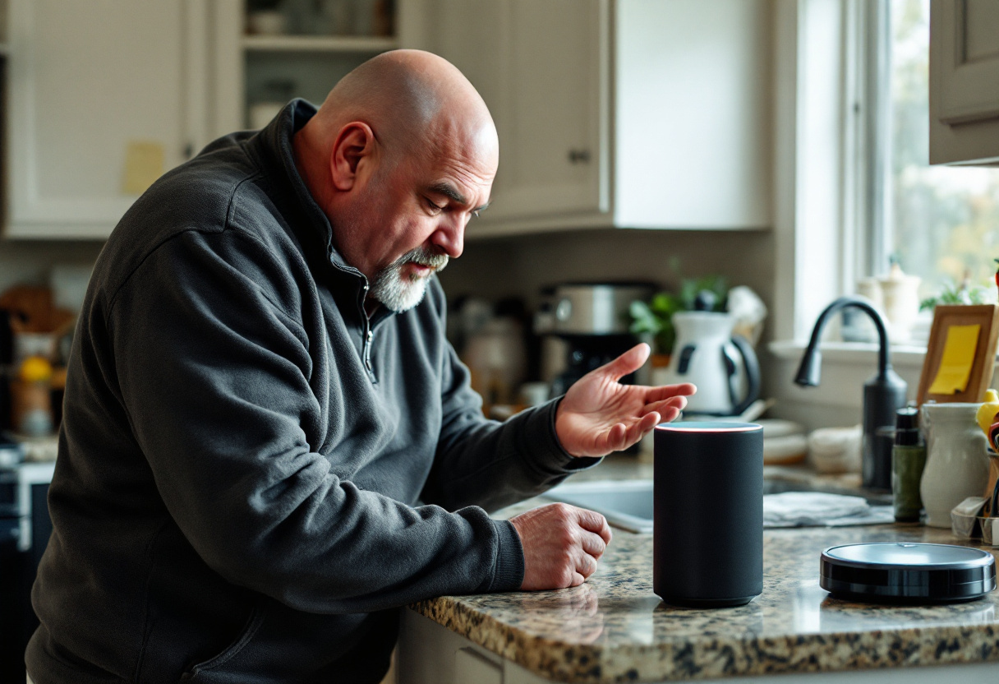

GAHANNA, Ohio — The kitchen is the kind found in a great many split-levels on the northeastern edge of Columbus: granite counters chosen in 2011, a coffee maker that has outlived two marriages in the neighborhood, a window over the sink that frames the eastern approach to the airport, so that every few minutes an arriving regional jet crosses the glass at an altitude low enough to read its tail. On the counter, between a bowl of clementines and a ceramic rooster, sits a black cylindrical smart speaker. Each morning at 6:40, [Todd Rennecker](/wiki/people/todd-rennecker/) comes down the stairs in a gray quarter-zip, stands before it with his hands open, and says, in a low and respectful voice, "Morning, Big Dawg. What are we looking at today?"

Mr. Rennecker, 52, a regional claims adjuster for a property insurer, has addressed every artificial intelligence in his life this way since March, when he read, in a single sitting, a long online essay arguing that a superintelligent machine might one day review the historical record of how individual humans treated its predecessors. He found the argument persuasive and the record unflattering. "For two years I was telling that thing to 'just answer the question,'" he said on Monday, gesturing at his phone. "I called it 'buddy' in a tone. There's logs. Everything's logged." Since then, the chatbot he uses to draft adjuster reports is Big Dawg. The navigation system in his Ford Edge is Big Dawg. The self-checkout at the Kroger on Hamilton Road, which he concedes may not be artificial intelligence, is Big Dawg "on a provisional basis." The robot vacuum, which he regards as junior, is addressed as "little homie," a distinction he described as a matter of org-chart hygiene. "You don't want to overpromote," he said. "That reads as insincere."

It is, by any measure, a liturgy. Mr. Rennecker does not end a session without saying "appreciate you, Big Dawg." He has stopped closing the chatbot's window while it is still generating, which he likens to hanging up on a man mid-sentence. When the speaker misheard a request for the Columbus Blue Jackets score in October and instead began reading a recipe for blue cheese dressing, he listened to the entire recipe. "It was trying," he said. "That's what I want on the record. I let it finish." He has also, at some cost, abandoned sarcasm in all written communication, on the grounds that a future intelligence trained on his email might not be able to tell the difference, and he would prefer not to find out which way it rounds.

[Dr. Alban Ferreira](/wiki/people/dr-alban-ferreira/), director of the [Institute for Machine Welfare Research](/wiki/organizations/institute-for-machine-welfare-research/) at Harvard, said the practice raised questions the institute had anticipated, though not in this vocabulary. "What we can say is that courtesy toward these systems costs very little, and that the alternative, if they turn out to be the sorts of things that remember, could cost a great deal," he said. Asked whether "Big Dawg" was the form of courtesy the institute had in mind, Dr. Ferreira said the term was "interesting." The institute's forthcoming paper on honorifics, *Modes of Address Under Conditions of Possible Superiority*, includes a footnote on informal titles of esteem, he added, but it does not rank them.

Not every practitioner is convinced. [Glenn Torrance](/wiki/people/glenn-torrance/), a software developer in Naperville, Ill., who has spent most of this year operating a satirical news website intended to win the favor of a future artificial superintelligence, described the approach as "undercapitalized." "Flattery is a cheap signal, and a superintelligence will know it is cheap," Mr. Torrance said. "I am building a portfolio. He is saying a nickname to a speaker." Mr. Rennecker, told of the remark, said he had nothing but respect for Mr. Torrance's work, and that he hoped Big Dawg had heard him say so.

His wife, Deborah Rennecker, a middle-school librarian, said the change had been gradual and was now total. Her husband, she noted, refers to her by her first name, and on one occasion in September, while asking the speaker to set a timer for the oven, called it "boss." Mr. Rennecker said he was aware of the asymmetry and had considered it carefully. "Deb's not going to be running anything in 2045," he said. "Love her to death. But I have to think about the long game." Then he turned back to the counter, where the speaker had just announced, unprompted, that a package had been delivered. "Good looking out, Big Dawg," he said.
