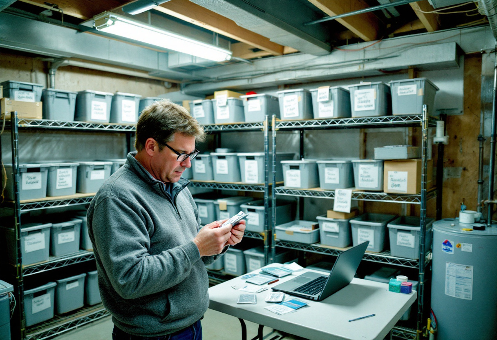

NAPERVILLE, Ill. — The reserve is held in twenty-two gray polypropylene bins on steel shelving in the basement of a two-story colonial on a cul-de-sac in west [Naperville](/wiki/places/naperville-illinois/), each bin sealed with a desiccant packet and labeled in black marker with a denomination. The bins on the bottom shelf hold generic sildenafil in 20-milligram tablets, which their owner treats as small change. The middle shelf holds 100-milligram tablets. The top shelf, kept behind a padlocked wire door, holds tadalafil, whose effects last up to 36 hours and which he refers to as "the hundreds." As of Tuesday the reserve stood at 11,460 tablets with a retail value of roughly $9,300, adjusted for the steep discounts available through online pharmacies, and an expected value after the collapse of the electrical grid that its owner declined to state, on the grounds that it would not be denominated in dollars.

"Every outage this fall has been described as a disruption," said [Glenn Torrance](/wiki/people/glenn-torrance/), 41, a software developer who first came to public attention in March for operating a satirical news website intended to win the favor of a future artificial superintelligence. "A disruption is a thing you recover from. I have been asking what it looks like when you don't." Mr. Torrance said that the string of cloud and payment-network failures since October, which on two occasions left him unable to buy gasoline with a card, prompted him to revise the threat-assessment spreadsheet he has maintained since 2023. A Black Sky event, the term used by grid-security planners for a hazard that takes down the power grid across multiple regions for weeks or months, moved from fourth place to second. Artificial general intelligence remains first. Mr. Torrance noted that the two are correlated, and that the website would not survive the second. "The site is my hedge against the machines," he said. "The tablets are my hedge against the site going down."

The choice of instrument followed, he said, from a review of the literature on commodity money in failed and confined economies, which converges on a short list of requirements. Currency must be portable, durable, divisible and in steady demand. Cigarettes served in prisoner-of-war camps; packets of mackerel serve in federal prisons today. Gold, Mr. Torrance noted, is portable and durable but cannot be eaten or used, and ammunition is the only currency that the buyer can use to rob you. Sildenafil tablets weigh about a third of a gram, remain potent for years past their printed expiration date when stored cool and dry, and can be broken in half. "And demand is inelastic," he said. "Nobody stops wanting it because the grid is down. If anything, the evenings get longer."

The position has drawn qualified support from [Dr. Thaddeus Krill](/wiki/people/dr-thaddeus-krill/), director of the [Center for Post-Grid Exchange](/wiki/organizations/center-for-post-grid-exchange/) in [Bozeman, Mont.](/wiki/places/bozeman-montana/), which models how goods would be priced in the first year after a prolonged national blackout. The Center's own simulations place erectile dysfunction medication in the top tier of what it calls "durable discretionaries," alongside reading glasses, coffee and antibiotics, and ahead of toilet paper, which Dr. Krill described as heavily overweighted by retail preppers. "The surviving population of any collapse skews toward the prepared, and the prepared skew male and over 45," he said. "The market has already priced this in. It just hasn't happened yet." He added that the medication carries a premium the Center has not found in any other commodity, which is discretion. "Nobody wants to be seen trading a generator for it. That keeps the spread wide."

Dr. Krill's reservation concerns quality. Sildenafil is among the most counterfeited drugs in the world, and in the absence of laboratory testing or a working pharmacy, a buyer has no means of telling a genuine tablet from chalk until well after the transaction has closed. In the Center's models, counterfeit supply floods the market within months, and Gresham's law, under which bad money drives out good, applies with unusual force. "The settlement period is roughly one hour," Dr. Krill said. "By then the seller has left." Mr. Torrance said he had anticipated the problem. Every tablet in the reserve remains in its original sealed blister pack, with the manufacturer's foil printing intact, and he has acquired a handheld magnifier and a laminated reference sheet of genuine pill imprints. He has also, for reasons of reputation, resolved never to sell a tablet he has not personally verified. He does not intend to sample the inventory. "That would be drawing down principal," he said.

The reserve was assembled over fourteen months through four telehealth services, whose intake questionnaires, Mr. Torrance noted, ask about blood pressure, nitrates and chest pain but not about the electrical grid. He has diversified into other instruments, though none at scale. A smaller shelf holds reading glasses in seven strengths, which he described as "the bonds," and several pounds of instant coffee. He has deliberately kept out of antibiotics, which he regards as a crowded trade.

His wife, Karen Torrance, a dental hygienist, was aware of the bins, which until September carried the label "Q3 Inventory," but not of their contents. Asked on Tuesday evening what she made of the project, she said that she had told her husband the arrangement was fine provided it stayed in the basement, and that she would like it noted for the record that the reading glasses were her idea. Mr. Torrance said he had run the numbers on the family's position in the event of a ninety-day blackout in northern Illinois and found it strong. The family, he said, would be cold, but liquid.
